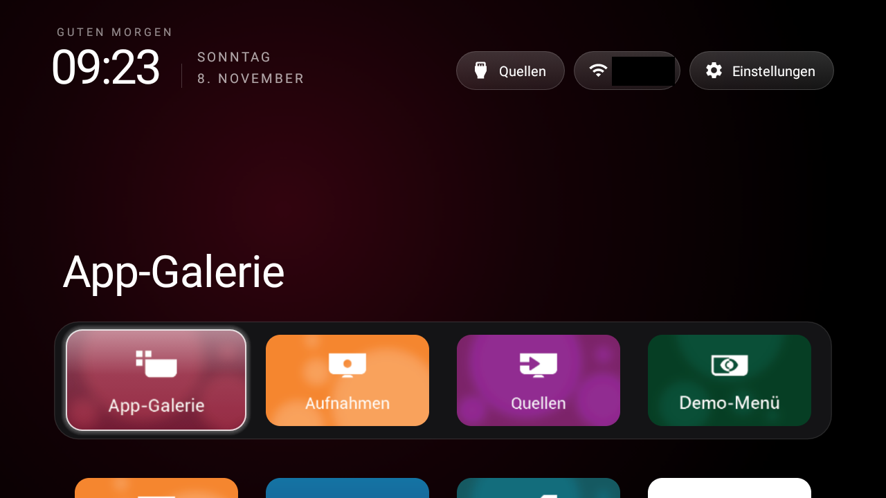

# Philips 32PFS6402 Home

**Community source port — development build, not an official CleanYourTV release.**

A source-only API25 compatibility port of the CleanYourTV reference launcher, with Philips LiveTV defaults. Public upstream project: Gathin23/cleanyourtv. Existing Android7 alternative: johnsontsai11/cleanyourtv-legacy. This tree is a separate preparation, not a claim that its changes have been accepted by either project. This community preparation is not affiliated with or endorsed by Philips or the upstream maintainers.

- Model-specific application ID `org.philips32pfs6402.home`; display name **Philips 32PFS6402 Home**. No owner or individual device name is embedded.
- Java-time desugaring, API25 package inventory, compatible resource-font loading, bounded captions reader and software wallpaper bitmaps.
- No new network permission, automatic key-filter service or boot takeover.
- Existing upstream MIT, font and icon licence notices are retained.

See [BUILD-AND-USE.md](BUILD-AND-USE.md) for prerequisites, portable build/test commands and recovery boundaries, and [tests/PORTING-NOTES.md](tests/PORTING-NOTES.md) for implementation and test limitations.

The earlier local port was exercised on Philips32PFS6402/12 with Android7.1.2 and firmwareQM164E.0.16.102.24. The neutral application identity in this preparation has **not** been installed or accepted on the TV. Source checks and host builds are distinct from real-device acceptance. There is no APK in this source export.

## Actual device capture and test limits

Actual ADB screenshot from the Philips 32PFS6402/12 on 8 November 2026, 1280×720. The Wi-Fi SSID is covered by an opaque black rectangle; no other visible content was edited. This shows the already installed pre-publication port, **not** device acceptance of the renamed application ID above. The power-key wake and subsequent standby were verified in Android's power/display state. This one cycle does not establish long-standby reliability.

See the [owner-review device report](docs/devices/philips-32pfs6402-12.md) for the Home, physical-remote, reboot, capture and rollback boundaries. This report belongs with the separate port; the planned main-project contribution is only a SHOWCASE listing. Sources and the privacy-edited image are provided on the `port/philips-32pfs6402-android7` branch. No upstream pull request has been opened.
